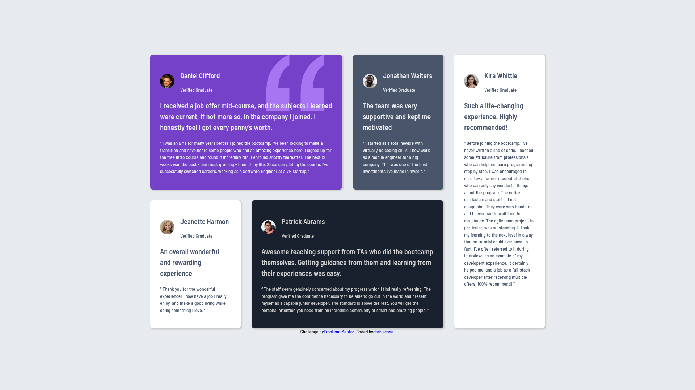
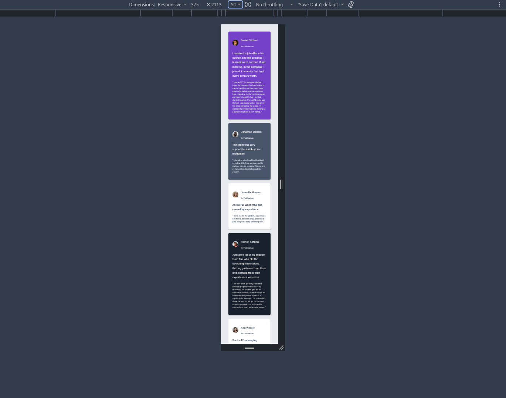

# Frontend Mentor - Testimonials Grid Section

This is my solution to the *Testimonials Grid Section* challenge from Frontend Mentor.

The project is built using HTML and CSS, with a focus on semantic HTML, CSS Grid, responsive design, custom fonts, and matching the provided desktop and mobile designs.

## 📸 Preview

### Desktop



### Mobile



## 🔗 Links

- Live Site: [View Live Site](https://astounding-hamster-c8eee6.netlify.app)
- Frontend Mentor: [View Challenge](https://www.frontendmentor.io/challenges/testimonials-grid-section-Nnw6J7Un7)

## 🛠️ Built With

- HTML5
- CSS3
- CSS Grid
- Flexbox
- Responsive Design
- Media Queries
- CSS Custom Properties
- Custom Local Fonts
- Semantic HTML

## 📚 What I Learned

While building this project, I practiced and improved my understanding of HTML and CSS.

### HTML

- Using semantic HTML elements
- Structuring a page using <main>, <article>, <section>, and other elements
- Organizing testimonial cards
- Linking external stylesheets
- Adding images with appropriate alt attributes

### CSS

- CSS Grid
- grid-template-columns
- grid-template-areas
- grid-column
- grid-row
- gap
- Flexbox
- align-items
- justify-content
- Responsive layouts
- Media queries
- CSS custom properties
- Background images
- background-position
- background-size
- Border radius
- Box shadows
- Typography

One of the main things I practiced was creating the desktop layout using CSS Grid and then changing the layout for smaller screens using a media query.

## 🎨 Design

The project was created by following the provided Frontend Mentor design reference.

The layout contains five testimonial cards:

- Daniel Clifford
- Jonathan Walters
- Jeanette Harmon
- Patrick Abrams
- Kira Whittle

The desktop version uses a multi-column CSS Grid layout, while the mobile version changes to a single-column layout.

## 📱 Responsive Design

The page is designed to work on different screen sizes.

### Desktop

The testimonials are arranged using CSS Grid with multiple columns and grid areas.

### Mobile

At smaller screen sizes, the layout changes to a single-column layout so that the cards appear one below another.

A CSS media query is used to control the mobile layout.

## 🔤 Fonts

The project uses the provided *Barlow Semi Condensed* font files.

The required font weights used in the project are:

- 500
- 600

The fonts are stored locally in the project, so the page does not depend on an external font service.

## 🧩 Project Structure

```text
project-folder/
│
├── images/
│   ├── bg-pattern-quotation.svg
│   ├── image-daniel.jpg
│   ├── image-jeanette.jpg
│   ├── image-jonathan.jpg
│   ├── image-kira.jpg
│   ├── image-patrick.jpg
│   ├── desktop-preview.jpg
│   └── mobile-preview.jpg
│
├── fonts/
│   └── Barlow_Semi_Condensed/
│       ├── BarlowSemiCondensed-Medium.ttf
│       └── BarlowSemiCondensed-SemiBold.ttf
│
├── index.html
├── style.css
├── normalize.css
└── README.md
```

## ✅ Validation

The project was tested using the W3C validation services.
HTML Validation
The HTML document was checked using the W3C HTML Validator.
Result: No errors or warnings were found.
CSS Validation
The CSS stylesheet was checked using the W3C CSS Validator.
Result: No errors were found.

## 💻 Development

This project was developed using:
Visual Studio Code
Google Chrome
Chrome DevTools
Live Server
Git
GitHub
Chrome DevTools was used to inspect the layout, typography, dimensions, and responsive behavior at different viewport sizes.

## 🚀 Running the Project Locally

To run the project locally:
Clone the repository.
git clone YOUR_GITHUB_REPOSITORY_URL
Open the project folder.
cd YOUR_PROJECT_FOLDER
Open index.html in your browser or use the Live Server extension in VS Code.

## 🌱 What I Would Improve

If I continue developing this project, I would like to further improve:
Pixel-level accuracy between the implementation and the reference design
Responsive behavior across additional screen sizes
Accessibility
CSS organization and maintainability
My understanding of advanced CSS Grid techniques

## 🧑‍💻 Author

Alex Chriss
GitHub: Chrisscode360tz⁠�
Frontend Mentor: @Alex Christopher

## 🙏 Acknowledgments

Frontend Mentor⁠� for providing the challenge and design.
The Frontend Mentor community for the learning resources and inspiration.
